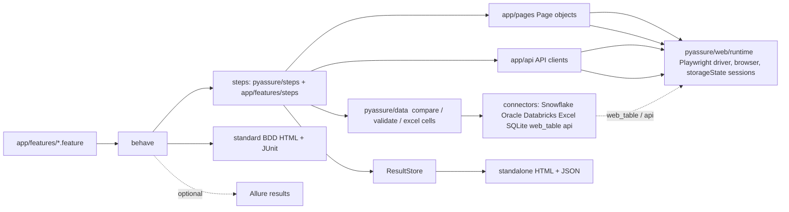

# 1. Overview and architecture

**PyAssure** - *A Quality Assurance framework in Python for UI, API and Database Testing.*

Scenarios are plain-English Gherkin ([behave](https://behave.readthedocs.io)); the UI and API layers use
[Playwright](https://playwright.dev/python/); databases and files are read into pandas DataFrames and compared or validated.

| Pillar | What you can do | Where it lives |
|---|---|---|
| **UI** | Page Object Model, storageState sessions, screenshots/trace/video on failure | `pyassure/web/pages.py`, `runtime.py` + your `app/pages/` |
| **API** | Playwright `APIRequestContext` client, typed clients, JSON assertions, request chaining | `pyassure/web/api.py` + your `app/api/` |
| **Database / files** | Compare Snowflake / Oracle / Databricks / Excel / SQLite / API / UI table by primary key; sanity validations; Excel cell-to-cell | `pyassure/data/` + your `app/datasets/` |
| **Cross-cutting** | parallel runner, encrypted secrets, standalone HTML + standard BDD + optional **Allure** reports | `pyassure/runner.py`, `secrets.py`, `reporting/` |

## The contract: framework vs application

```
pyassure/   FRAMEWORK - generic, reusable. You should never need to edit it.
app/        APPLICATION - everything specific to the system under test. The ONLY place a project team changes.
```

| You change (in `app/`) | Examples |
|---|---|
| `config/pyassure.yml` | base URL, browser, sessions, Allure on/off, parallel defaults, app server command |
| `config/connections.yml` | database connections (secrets as `${ENV}` or `ENC(...)`) |
| `pages/` | page objects: selectors + user actions for each page |
| `api/` | typed API clients: one method per endpoint |
| `auth.py` | how to log in (session providers) |
| `datasets/` | compare / validation / Excel-compare YAML files |
| `features/*.feature` | the scenarios |
| `features/steps/app_steps.py` | business-language steps that call page objects / API clients |
| `data/`, `demo_app/` | test data (and the demo application - delete it for your own app) |

The framework reaches into `app/` only through **configuration** (module name `sessions.providers`, file paths in YAML)
and **imports you control** (`app/features/steps/framework_steps.py`). Upgrading PyAssure = replacing the `pyassure/` folder.

## Architecture



**Everything is a DataFrame.** A connector turns a query into a DataFrame, so any two sources compare with each other:
database vs Excel, Oracle vs Snowflake, **database vs the table on a web page** (`web_table`), **database vs an API
response** (`api`).

**One Playwright driver per process.** UI pages, API clients, session logins and the `web_table`/`api` connectors all share
it (`runtime()`); API-only runs never start a browser.

## Life of a scenario

1. `app/features/environment.py` -> `pyassure.hooks.before_all`: read `-D` options, start the app server if configured,
   create the result store, attach Allure when enabled.
2. Steps run. Assertions go through `checkpoint()`: recorded (expected/actual/evidence) whether they pass or fail,
   mirrored to Allure.
3. On failure `after_step` adds a screenshot; `after_scenario` closes the browser context/API clients and keeps trace/video.
4. `after_all` writes `validation_report.html` + JSON and stops the server it started.

## Package map (`pyassure/`)

| Module | Responsibility |
|---|---|
| `config.py` | YAML + `${ENV}` + project paths, **settings defaults** (`DEFAULTS`), named connections |
| `secrets.py` | `ENC(...)` encryption, key handling, CLI |
| `data/connectors.py` | all sources + factory + `fetch_dataset()` |
| `data/compare.py`, `validate.py`, `excel_cells.py` | the three engines |
| `web/runtime.py` | Playwright runtime, per-scenario pages, **storageState sessions** |
| `web/pages.py` | `BasePage`, `Component`, `TableComponent`, `page_object()` |
| `web/api.py` | `ApiClient`, `ApiResponse`, `json_path()`, `api_client()` |
| `steps/data_steps.py`, `ui_steps.py`, `api_steps.py` | reusable step libraries |
| `reporting/store.py`, `html.py`, `allure_support.py`, `bdd_html.py` | result model + three report types |
| `hooks.py`, `bdd.py`, `services.py`, `runner.py` | lifecycle, `checkpoint()`, app server, parallel runner |
